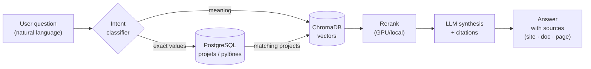
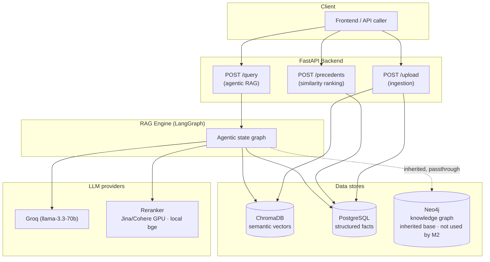
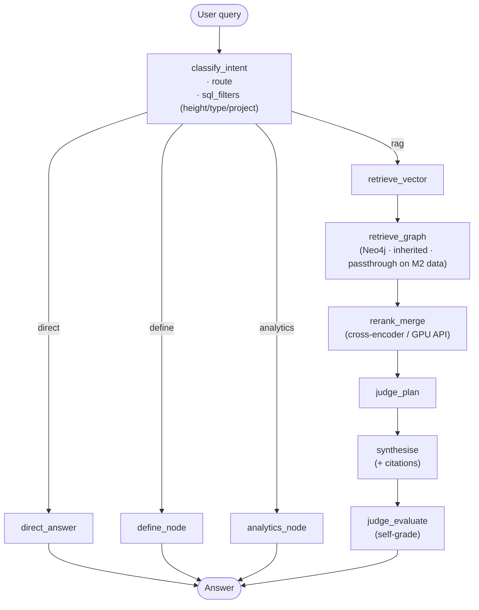
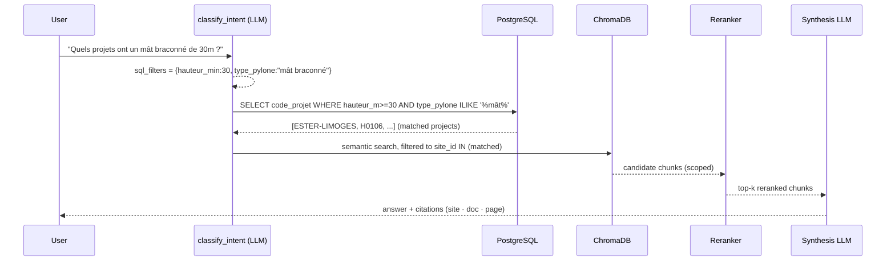
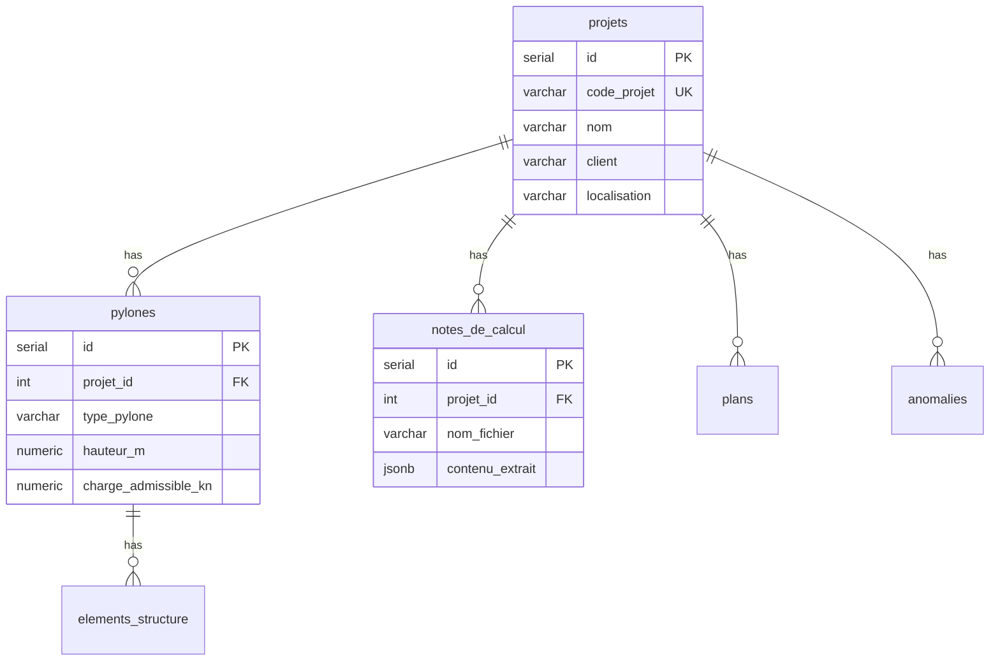
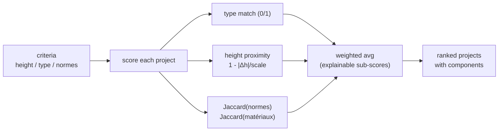
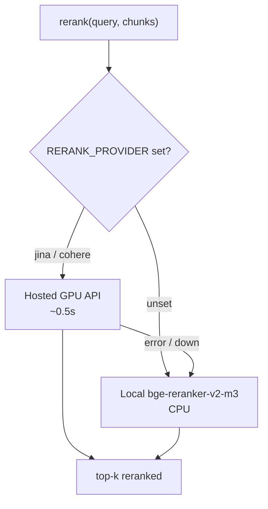

# M2 — Répondre · Technical Architecture

> **Module M2 of the BIMLO RAG Copilot** — an *agentic* RAG system that answers
> technical questions about past telecom-pylon projects with **cited sources**,
> **hybrid semantic + structured search**, and **precedent (closest-project)
> retrieval**.
>
> Owner: Mohamed Ali Abid (Lead RAG / Backend)

---

## 1. What M2 does — in one idea

> **Vectors for meaning. A SQL database for exact facts. An LLM router to decide
> which to use. Citations so humans can verify. A judge LLM to grade the result.**

Plain RAG can find *text that talks about* "a 30 m mât braconné", but it can't
reliably answer *"which projects have a pylon ≥ 30 m of type mât braconné?"* —
that's exact filtering, a database job. M2 combines both.



---

## 2. High-level architecture



> **Scope note:** ChromaDB + PostgreSQL are the stores M2 built on and populates.
> **Neo4j is inherited from the base project** — M2's ingestion does not populate
> it and the graph node passes through on M2 data (see §3). It is drawn only for
> completeness of the running stack.

---

## 3. The agentic query pipeline (LangGraph)

Unlike plain RAG (always retrieve → generate), M2 **first decides what to do**.
An LLM intent classifier picks a *route* and, crucially, **extracts structured
SQL filters from the natural-language query**.



**Key M2 addition:** `classify_intent` now outputs `sql_filters`, e.g.
`"mât braconné de 30m"` → `{hauteur_min: 30, type_pylone: "mât braconné"}`.
When present, `retrieve_vector` switches to **hybrid search**.

---

## 4. Hybrid search — the heart of M2

When the query carries structured criteria, the SQL side runs first and **scopes**
the semantic search to only the matching projects ("strict project locking").



**Verified on the 24 real projects:**

| Query criteria | SQL matched | Behaviour |
|---|---|---|
| `projet = ESTER` | 1 project | locked to ESTER-LIMOGES only |
| `type = mât braconné` | 11 projects | scoped to those |
| `hauteur_min = 30` | 2 (ESTER/NEVILLE, 36 m) | graded |
| `projet = Tunis-A45` (absent) | 0 | **0 chunks, no leakage** |

**Efficiency win:** tight filter (ESTER → 13 chunks) reranks in ~0.5 s vs a
full-corpus scan — up to **~20× faster** end-to-end (see §7).

---

## 5. Data model (PostgreSQL)

The canonical schema (owned by the data team) — M2 reads `projets` + `pylones`
for filtering, and `notes_de_calcul.contenu_extrait` (JSONB) for precedent scoring.



Ingestion (`scripts/ingest_json.py`) loads each project JSON into **both** stores:
structured rows → PostgreSQL, and `texte_complet` → embedded chunks in ChromaDB
(tagged with `site_id`, `project_name`, `doc_type` for filtering + citations).

---

## 6. Citations & precedent retrieval

### Precise citations
PDFs are chunked **page-by-page**, so every chunk carries a `page_number`. Plus an
LLM tags each document with `project_name` / `site_id`. These locators are injected
into the `[Source N]` headers the synthesis LLM sees, so answers cite *"…on page 2,
site T-1234"*, and the returned source cards expose them.

### Precedent similarity — "projet le plus proche"
Beyond exact filtering, `services/precedent.py` ranks projects by **proximity**,
exposed at `POST /precedents`:



Verified: `36 m triangulaire` → ESTER/NEVILLE **1.0**, treillis 24 m **0.7**,
non-match **0.0**.

---

## 7. Reranking — local vs hosted GPU

The cross-encoder reranker scores candidate chunks for exact relevance. On CPU it
was the bottleneck (150–230 s). A hosted-provider branch (Jina/Cohere GPU) drops
this to sub-second, with **automatic fallback to the local model**.



| | Local CPU | Jina GPU |
|---|---|---|
| Rerank step | 150–230 s | **0.54 s** |
| Full query | ~230 s | **11.8 s** |
| Answer quality | baseline | unchanged |

> ⚠️ Hosted reranking sends chunk text to a 3rd party — enabled for the
> **prototype**; requires data-governance sign-off before production.

---

## 8. Tech stack & endpoints

| Layer | Technology |
|---|---|
| API | FastAPI (streaming) |
| Orchestration | LangGraph agentic state machine |
| Vector store | ChromaDB (`all-MiniLM-L6-v2` embeddings) |
| Structured store | PostgreSQL 16 (Docker, auto-schema) |
| Knowledge graph | Neo4j *(inherited base — not populated/used by M2)* |
| LLM | Groq (`llama-3.3-70b-versatile`) |
| Reranker | Jina / Cohere (GPU) · `bge-reranker-v2-m3` (local fallback) |

| Endpoint | Purpose |
|---|---|
| `POST /query` | Agentic RAG Q&A (routing, hybrid, citations, streaming) |
| `POST /precedents` | Structured precedent similarity ranking |
| `POST /upload` | Document ingestion → Chroma + Neo4j |

---

## 9. What is verified — and honest limitations

**Verified end-to-end on the 24 real projects**
- ✅ Intent routing (direct / define / rag)
- ✅ NL → `sql_filters` → hybrid project/type/height locking (evidenced in logs)
- ✅ Citations (site + page) surfaced to the answer
- ✅ Precedent ranking (graded, explainable) via `POST /precedents`
- ✅ ~20× faster reranking with hosted GPU
- ✅ Correct sample answers (heights, wind load, project lists)

**Honest limitations**
- ⚠️ **Answer quality not measured systematically** — the pertinence suite runs
  on placeholder Q&A. Full validation on the real corpus is an *integration-phase*
  task (real Golden set + LLM-judge report).
- ⚠️ **Retrievability gap** — some structured facts (e.g. Eurocode `normes`) live in
  `donnees_extraites`, not in the embedded text, so a semantic query for them can
  return an empty answer. (Precedent scoring uses the JSONB directly and is fine.)
- ⚠️ **Height coverage** — 7/24 pylons carry a height in the source JSON; the rest
  have it nowhere, so the height filter only applies where data exists.
- ⚠️ **Prototype privacy** — hosted reranking sends client text out.

---

## 10. Run it locally

```bash
cd 00-base-amine/Backend

# 1. Start the stack (postgres + neo4j + chroma + api); schema auto-applies
docker compose up -d --build

# 2. Ingest the 24 projects → PostgreSQL + ChromaDB
docker exec backend-api-1 python scripts/ingest_json.py

# 3a. Hybrid lock smoke test
docker exec backend-api-1 python scripts/test_final_m2.py

# 3b. Precedent endpoint
curl -X POST http://localhost:8000/precedents \
  -H "Content-Type: application/json" \
  -d '{"hauteur_m":36,"type_pylone":"triangulaire","top_n":5}'

# 3c. Pertinence framework (LLM-judge → CSV)
docker exec backend-api-1 pytest tests/test_pertinence.py -v -s
```

Optional GPU reranking: set `RERANK_PROVIDER=jina` + `JINA_API_KEY` in `.env`.
