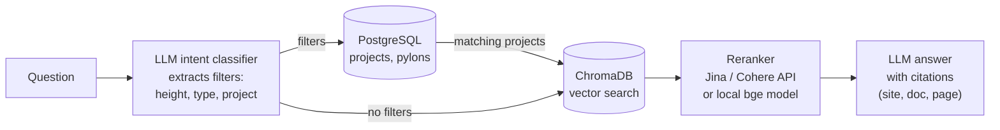

# RAG Q&A for telecom pylon projects

Ask questions about past telecom pylon projects in plain language, and get answers that cite the site, the document and the page. Built for structural engineers at BIMLO.

> I built this during my internship at BIMLO (2026). My part is the retrieval layer: hybrid search, project locking, page-level citations and precedent ranking. It runs on top of a base RAG application written by Mohamed Amin Helali at BIMLO. See [What I built](#what-i-built) and [Credits](#credits).

<!-- TODO: add a screenshot or GIF of a question answered with cited sources -->

## How it works



A second endpoint, `POST /precedents`, skips the LLM. It scores every past project against the criteria you give it and returns them ranked.

## The problem

Engineers often solve a question that a past project already answered. The answer sits somewhere in old calculation notes and plans.

Plain vector search finds text *about* "a 30 m pylon". It cannot reliably answer "which projects have a pylon of 30 m or more?". That is an exact filter, and exact filters are a database job.

## My approach

- **Filters from plain language.** The intent classifier (an LLM call) turns `"mât braconné de 30m"` into `{"hauteur_min": 30, "type_pylone": "mât braconné"}`.
- **Database first, then vectors.** PostgreSQL applies the filters and returns the matching projects. ChromaDB then searches only inside those projects. If no project matches, the search returns nothing instead of answering from the wrong project.
- **Page-level citations.** PDFs are split page by page, so every chunk keeps its page number and site ID. The answer cites both.
- **Closest past project.** `POST /precedents` ranks projects by pylon type, height difference, and overlap of standards and materials. It returns each sub-score, so an engineer can see why a project ranked high.
- **Faster reranking.** The reranker can call a hosted GPU API (Jina or Cohere). If that call fails, it falls back to the local `bge-reranker-v2-m3` model.

## Results

I checked these by hand on 24 real BIMLO projects. The dataset is confidential and is not in this repo.

| Check | Result |
|---|---|
| Question names one project | Search locked to that 1 project |
| Question names a pylon type | Search scoped to the 11 matching projects |
| Question names a project that does not exist | 0 chunks returned, nothing pulled from other projects |
| Precedent query: 36 m, triangular | Exact match scored 1.0, a 24 m lattice tower 0.7 |
| Rerank step: local CPU vs Jina API | 150 to 230 s → 0.54 s |
| Full query: local CPU vs Jina API | about 230 s → 11.8 s |

**Limits**

- I have not measured answer quality on a real test set. The test harness ([`tests/test_pertinence.py`](backend/tests/test_pertinence.py), LLM-as-judge with a CSV report) works, but it still runs on placeholder questions.
- Only 7 of the 24 pylons have a height in the source data, so the height filter only helps on those.
- The hosted reranker sends document text to a third party. It is off by default.

## What I built

About 1,500 lines across 29 files. My commits are in the history under the author name `dali`.

| File (under `backend/`) | What I added |
|---|---|
| [`services/intent_classifier.py`](backend/services/intent_classifier.py) | Extracts `sql_filters` (height, type, project) from the question |
| [`services/vector_store.py`](backend/services/vector_store.py) | `hybrid_search()`: SQL filter first, then a scoped ChromaDB search |
| [`services/db.py`](backend/services/db.py), [`db/init/`](backend/db/init) | Moved the structured store from SQLite to PostgreSQL, using the team's shared schema |
| [`scripts/ingest_json.py`](backend/scripts/ingest_json.py) | Loads project JSON files into PostgreSQL and ChromaDB |
| [`services/document_processor.py`](backend/services/document_processor.py) | Page-by-page PDF chunking with page and site metadata |
| [`services/precedent.py`](backend/services/precedent.py), [`routers/precedents.py`](backend/routers/precedents.py) | Precedent scoring and the `POST /precedents` endpoint |
| [`services/reranker.py`](backend/services/reranker.py) | Hosted Jina / Cohere reranking with local fallback |
| [`tests/test_pertinence.py`](backend/tests/test_pertinence.py) | LLM-as-judge test harness with a CSV report |

## Tech stack

- **API:** Python, FastAPI
- **Agent graph:** LangGraph (from the base app)
- **Vector store:** ChromaDB with `all-MiniLM-L6-v2` embeddings
- **Structured store:** PostgreSQL 16
- **LLM:** Groq, Llama 3.3 70B
- **Reranker:** `bge-reranker-v2-m3` locally, Jina or Cohere as a hosted option
- **Tooling:** Docker Compose, pytest
- **From the base app:** React + TypeScript + Vite frontend, Neo4j for users and sessions

## How to run it

**You need:** Docker with Docker Compose, a [Groq API key](https://console.groq.com), and project data as JSON files (one file per project, not included).

From the repo root:

```bash
cp backend/.env.example backend/.env
cp frontend/.env.example frontend/.env
# Edit backend/.env: set at least GROQ_API_KEY

# Start PostgreSQL, ChromaDB, Neo4j, the API and the frontend.
# The PostgreSQL schema is applied on first boot.
docker compose up -d --build
```

Put your project JSON files in `data/projects/` (gitignored), then load them:

```bash
docker compose exec api python scripts/ingest_json.py
```

Try it:

```bash
# Ask a question. Hybrid search starts when the question contains filters.
curl -X POST http://localhost:8000/query \
  -H "Content-Type: application/json" \
  -d '{"query": "Quels projets ont un mât braconné de 30 m ?", "session_id": "global"}'

# Rank past projects by closeness
curl -X POST http://localhost:8000/precedents \
  -H "Content-Type: application/json" \
  -d '{"hauteur_m": 36, "type_pylone": "triangulaire", "top_n": 5}'
```

- Frontend: http://localhost:3000
- API docs: http://localhost:8000/docs

Run the checks:

```bash
docker compose exec api python scripts/smoke_hybrid_search.py   # hybrid search smoke test
docker compose exec api pytest tests/test_pertinence.py -v -s
```

To use the hosted reranker, set `RERANK_PROVIDER=jina` and `JINA_API_KEY` in `backend/.env`.

## Project structure

```
backend/
├── main.py              FastAPI app
├── core/                settings, loaded from backend/.env
├── routers/             API endpoints (chat, documents, precedents, ...)
├── services/            RAG engine, vector store, reranker, precedent scoring
├── prompts/             LLM prompt templates
├── db/init/             PostgreSQL schema, applied by Docker on first boot
├── scripts/             data ingestion and smoke test
└── tests/               pytest suites
frontend/                React + TypeScript UI (base app)
data/projects/           your project JSON files (gitignored)
docker-compose.yml       the full stack
```

## Credits

- **Base RAG application** (FastAPI backend, React frontend, LangGraph agent graph, auth, reports): Mohamed Amin Helali, BIMLO.
- **Project, data and supervision:** BIMLO.
- **Retrieval layer** described above: me.

## License

No open-source license. This code was written during an internship at BIMLO and is shown here as a portfolio piece. Please do not reuse it without permission.

---

Dali Abid · [Portfolio](https://adeilm.github.io) · [GitHub](https://github.com/adeilm)
