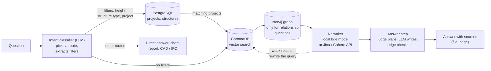

# RAG Q&A for construction projects

An assistant for construction and architecture teams. Engineers ask questions about their project documents and building models in plain language. They get an answer plus the sources it used: file and page.

The goal is a SaaS product for construction companies. See [Status](#status) for where it stands today.

## What it does

- **Answers questions about project documents** (PDF, Word, text, images) and lists the sources behind each answer. Drawings and photos inside documents are described by a vision model, so their content is searchable too.
- **Reads BIM and CAD files.** You can ask about an IFC model's elements, storeys, materials and quantities. CAD drawings (DXF, with basic DWG and STEP support) are converted to IFC on upload. Models open in a 3D viewer in the browser.
- **Applies exact filters from the question.** "Projects with a structure of 30 m or more" becomes a SQL query on the project database. The text search then runs only inside the matching projects. If no project matches, it returns nothing instead of pulling text from other projects.
- **Finds the closest past project.** `POST /precedents` ranks past projects by structure type, height, design standards and materials, and returns a sub-score for each criterion.
- **Also included:** charts built from document data, PDF and Markdown reports, voice input and a voice call mode, a news page, user accounts with separate document collections, and an admin page. The interface is in English, French and Arabic.

## How it works



1. **Classify.** An LLM reads the question, picks a route (document Q&A, direct answer, chart, report, CAD and others) and extracts filters such as minimum height, structure type or project code.
2. **Filter, then search.** With filters, PostgreSQL returns the matching projects and ChromaDB searches only their text chunks. Without filters, ChromaDB searches every document the user can see.
3. **Add graph context.** When the question asks how things are connected, the app writes a Cypher query against a Neo4j graph. The graph holds entities (storeys, rooms, walls, beams, materials, standards and more) extracted from the uploaded documents.
4. **Rerank.** A cross-encoder scores each chunk against the question. It runs locally (`bge-reranker-v2-m3`) or through the Jina or Cohere API, and falls back to the local model if the API call fails. If the results are still weak, the query is rewritten and searched again.
5. **Answer.** An LLM judge plans the answer, the LLM writes it with sources, and the judge checks it. A weak answer gets one more attempt.

Uploaded files go through their own pipeline. PDFs are split page by page, so every chunk keeps its page number. Chunks are stored in ChromaDB and entities in Neo4j.

LLM calls go through a list of providers (Cloudflare Workers AI, OpenRouter, Groq, NVIDIA). If one fails or runs out of quota, the next one takes over.

## Tech stack

- **Backend:** Python 3.11, FastAPI, LangGraph
- **Search:** ChromaDB with `all-MiniLM-L6-v2` embeddings, PostgreSQL 16, Neo4j
- **Reranking:** `bge-reranker-v2-m3` locally, Jina or Cohere as a hosted option
- **LLMs:** Groq (Llama 3.3 70B, Llama 3.1 8B), Cloudflare Workers AI, OpenRouter, NVIDIA
- **BIM and documents:** IfcOpenShell, ezdxf, xeokit (3D viewer), pdfplumber, python-docx, ReportLab
- **Voice:** Whisper on Groq (speech to text), ElevenLabs (text to speech)
- **Frontend:** React 18, TypeScript, Vite, Tailwind CSS, shadcn/ui, Chart.js, i18next
- **Tooling:** Docker Compose, pytest, Vitest, Playwright

## How to run it

**You need:** Docker with Docker Compose and a [Groq API key](https://console.groq.com). For the structured search you also need project data as JSON files, one file per project. No data is included in this repo.

From the repo root:

```bash
cp backend/.env.example backend/.env
cp frontend/.env.example frontend/.env
# Edit backend/.env and set GROQ_API_KEY. Every other key is optional.

# Starts ChromaDB, PostgreSQL, Neo4j, the API and the frontend.
docker compose up -d --build
```

The PostgreSQL schema is applied on first boot. The API waits for Neo4j to pass its health check, so the first start can take a few minutes. The local reranker model is downloaded on first use and cached in a Docker volume.

Load your project data. Put the JSON files in `data/projects/` (gitignored), then run:

```bash
docker compose exec api python scripts/ingest_json.py
```

Open the app:

- Frontend: http://localhost:3000
- API docs: http://localhost:8000/docs

Or call the API directly:

```bash
# Ask a question. Filters in the question, such as a minimum height, trigger the structured search.
curl -X POST http://localhost:8000/query \
  -H "Content-Type: application/json" \
  -d '{"query": "Which projects have a structure of 30 m or more?", "session_id": "global"}'

# Rank past projects by how close they are to the criteria
curl -X POST http://localhost:8000/precedents \
  -H "Content-Type: application/json" \
  -d '{"hauteur_m": 30, "normes": ["EN 1993-1-1"], "materiaux": ["S355"], "top_n": 5}'
```

To use the hosted reranker, set `RERANK_PROVIDER=jina` and `JINA_API_KEY` in `backend/.env`. The hosted API receives the text of your documents, so it is off by default.

Stop everything with `docker compose down`.

## Status

- It runs as a self-hosted app with Docker Compose. Accounts for multiple companies and billing are not built yet.
- The project database, the search filters and several prompts still target a single structure type (telecom towers), because that is what the first dataset contained. Making them work for buildings in general is the next step.

## Credits

- **Base RAG application** (FastAPI backend, React frontend, LangGraph agent graph, auth, reports): Mohamed Amin Helali.
- **Retrieval layer** (hybrid search, project filtering, page-level citations, precedent ranking, hosted reranker): me.

No open-source license. Please do not reuse this code without permission.

---

Dali Abid · [Portfolio](https://adeilm.github.io) · [GitHub](https://github.com/adeilm)
